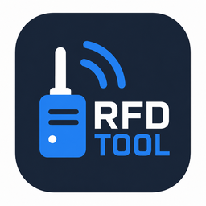

# RFDTool

<p align="center">
  
</p>

RFDTool is a utility for Linux, Windows, and Android for inspecting and configuring
RFD900-class and SiK-compatible radio modems. It talks to a locally connected modem over serial,
then can read and configure both the local radio and the remote radio across the
radio link.

Use it when you want a clearer, safer interface than typing AT commands by hand.

## Download

Prebuilt binaries are attached to the
[latest GitHub release](../../releases/latest):

- `RFDTool-x86_64.AppImage` for Linux on Intel/AMD 64-bit.
- `RFDTool-aarch64.AppImage` for Linux on ARM 64-bit, such as Raspberry Pi OS 64-bit.
- `RFDTool-Setup.exe` for Windows.
- `RFDTool-arm64-v8a.apk` for Android phones and tablets (Android 12+).
- `RFDTool-x86_64.apk` for Android emulators.

Android downloads are debug-signed alpha builds for sideloading.

Linux packages target Ubuntu 24.04 or a compatible newer distribution.

The ARM AppImage should work on Raspberry Pi-class boards running a 64-bit Linux
desktop. It has been tested on an Orange Pi running Ubuntu 24.04.

On Linux, make the AppImage executable before running it:

```sh
chmod +x RFDTool-x86_64.AppImage
./RFDTool-x86_64.AppImage
```

On Windows, download and run:

```text
RFDTool-Setup.exe
```

Windows users do not need to install SQGI, Ooblerg, MSYS2, MinGW, GTK, or any
developer tooling just to run RFDTool. The installer contains what the app needs.

Ooblerg is only needed if you want to run or modify RFDTool from source on
Windows.

Select a serial device from the device list; the default baud rate is `57600`.
Use the refresh button beside the list after attaching or unplugging an adapter.
Linux device paths and Windows COM ports can also be entered manually.

## Quick Start

1. Plug the local radio modem into your computer.
2. Power the remote radio and make sure the radio link is up.
3. Start RFDTool.
4. Choose the serial device and baud rate, then connect. On Android, grant the
   system USB permission prompt for the selected adapter.
5. Click the local and remote refresh buttons to read firmware and settings.
6. Edit the settings you need.
7. Use `Apply Local` or `Apply Remote` to write changes to the running radio.
8. Use `Save Both` to persist applied changes to EEPROM.
9. Use `Save + Reboot` when firmware or radio-critical settings need a restart.

If you are changing settings that must match on both radios, apply the remote
side first. If the link drops after changing only the local side, RFDTool may no
longer be able to reach the remote radio.

To copy one directly connected radio to another, refresh the first radio, then
disconnect and connect the second radio without refreshing it. Enable
`Write all loaded settings`, use `Apply Local`, then save when the write is
complete.

## Local, Remote, Apply, Save

RFDTool shows the two sides separately:

- Local is the modem connected directly to your computer.
- Remote is the modem reached through the radio link.

RFD and SiK firmware make an important distinction between applying and saving:

- `Apply` writes the setting into the running radio.
- `Save` writes the current settings to EEPROM so they survive power loss.
- `Reboot` restarts the modem so startup-time settings take effect.
- `Write all loaded settings` makes Apply write every reported writable setting
  for the selected side, including values that are not staged as changes.

For remote changes, RFDTool sends `RT...` commands through the local modem. That
requires a working radio link and can take longer than local `AT...` commands,
especially after rebooting the remote radio.

## Features

- Connect to local RFD/SiK radios over a serial port.
- Discover Linux serial devices, Windows COM ports, and Android USB OTG adapters.
- Read local and remote firmware information.
- Read, edit, stage, apply, save, and reboot supported modem parameters.
- Show which settings are reported by the connected firmware.
- Configure AES keys, including generated random 128-bit or 256-bit keys.
- Run RSSI/TDM diagnostics and graph RSSI/noise over a rolling 60 second window.
- Export and import JSON configuration profiles.
- Send manual AT commands from the built-in terminal.

## Troubleshooting

### RFDTool cannot open the serial port on Linux

Check the device ownership:

```sh
ls -l /dev/ttyUSB0
id
```

Serial devices are commonly owned by a group such as `dialout`. Add your user to
the device group, then log out and back in:

```sh
sudo usermod -aG dialout "$USER"
```

Use the actual group shown by `ls -l` if the device is not owned by `dialout`.

### RFDTool cannot open the serial port on Windows

Make sure you selected the correct `COM` port.

You can check the port in Windows Device Manager under:

```text
Ports (COM & LPT)
```

Also make sure no other application is currently using the modem. Serial ports
are usually exclusive, so tools such as Mission Planner, MAVProxy, another
terminal, or another RFDTool instance may block access.

### Local refresh works, but remote refresh does not

Check that:

- the remote radio is powered;
- both antennas are connected;
- the radio link is actually up;
- both radios still agree on link-critical settings.

Settings that commonly need to match include:

- network ID
- air speed
- frequency range
- channel count
- ECC
- MAVLink framing
- encryption

If a setting change breaks the radio link, connect to the affected radio
directly over serial and restore compatible settings.

### Android USB devices

On Android, use a phone or tablet with USB host support and a USB OTG adapter.
Select the USB serial adapter, press `Connect`, and allow the system permission
prompt. `Cancel` stops a pending connection. Permission denial or unplugging the
adapter leaves the app disconnected; refresh and reconnect when ready. Device
names describe the USB adapter, not the radio attached to it. Adapters without a
unique USB serial number may need to be selected again after unplugging.

## Safety

Radio settings are regulated. Do not use this tool to bypass certified
frequency, region, duty-cycle, or transmit-power limits.

Some settings need to match on both radios, including network ID, air speed,
frequency range, channel count, ECC, MAVLink framing, and encryption. Changing
only one side can intentionally break the link until the other side is updated.

## Developers

RFDTool is written in SQGI/Squirrel, uses GTK 4 for the interface, and uses the
GSerial native module (0.3.0 or newer) for serial device discovery and access.

The normal source workflow is:

```sh
sqgi main.nut
```

Release packaging is handled by `sqgipkg` and GitHub Actions.

## Windows development with Ooblerg

The recommended Windows development setup is
[Ooblerg](https://ooblerg.xyz/).

Ooblerg is a Windows package manager and MinGW-w64 sysroot for SQGI, GTK4,
Vala, Meson, pkg-config, GStreamer, and related native app development. It lets
you install the tools and libraries RFDTool needs into a managed sysroot, then
run the app from Command Prompt, PowerShell, or VS Code.

This is the easiest way to hack on RFDTool from Windows without manually setting
up MSYS2, GTK, MinGW, pkg-config paths, or native library search paths.

### Setup

1. Install [Ooblerg](https://ooblerg.xyz/).
2. Launch Ooblerg.
3. Refresh the package index.
4. Install the packages needed by RFDTool:

```text
sqgi
gtk4
gserial
```

5. In Ooblerg, check that the MinGW sysroot is added to `PATH`.
6. Open a fresh Command Prompt, PowerShell window, or VS Code terminal.
7. Clone and run RFDTool:

```sh
git clone https://github.com/supercamel/RFDTool.git
cd RFDTool
sqgi main.nut
```

If `sqgi` is not found, close and reopen your terminal after enabling the
Ooblerg sysroot in `PATH`.

If GTK or GSerial cannot be found, check that `gtk4` and `gserial` are installed
in Ooblerg.

### Useful Windows commands

Run the self-tests:

```sh
sqgi main.nut --self-test
```

Probe a local modem without launching the GUI:

```sh
sqgi main.nut --probe --device=COM3 --baud=57600
```

Exercise the local settings load path from the command line:

```sh
sqgi main.nut --refresh-local --device=COM3 --baud=57600
```

Replace `COM3` with the actual serial port used by your modem.

## Linux development from source

The following commands target Ubuntu 24.04.

Running directly with `sqgi main.nut` on Linux requires SQGI, GSerial, and GTK 4
runtime packages to be installed on the system.

Install SQGI from <https://github.com/supercamel/sqgi>:

```sh
git clone https://github.com/supercamel/sqgi.git
cd sqgi

sudo apt install cmake build-essential pkg-config \
  libglib2.0-dev libgirepository1.0-dev libffi-dev libcairo2-dev

cmake -S . -B build -DCMAKE_BUILD_TYPE=Release \
  -DSQ_ENABLE_JIT=OFF -DSQGI_ENABLE_KERNELS=OFF
cmake --build build -j"$(nproc)"
sudo cmake --install build --prefix /usr/local
sudo ldconfig
export GI_TYPELIB_PATH=/usr/local/lib/girepository-1.0${GI_TYPELIB_PATH:+:$GI_TYPELIB_PATH}
```

Install GSerial from <https://github.com/supercamel/gserial>:

```sh
git clone https://github.com/supercamel/gserial.git
cd gserial

sudo apt install build-essential meson ninja-build pkg-config \
  libglib2.0-dev libgirepository1.0-dev

meson setup build --prefix=/usr/local --libdir=lib
meson compile -C build
sudo meson install -C build
sudo ldconfig
export GI_TYPELIB_PATH=/usr/local/lib/girepository-1.0${GI_TYPELIB_PATH:+:$GI_TYPELIB_PATH}
```

Install GTK 4 runtime/introspection packages if they are not already present:

```sh
sudo apt install libgtk-4-1 gir1.2-gtk-4.0
```

Then run RFDTool:

```sh
git clone https://github.com/supercamel/RFDTool.git
cd RFDTool
sqgi main.nut
```

## Useful developer commands

Run the self-tests:

```sh
sqgi main.nut --self-test
```

List serial devices without opening them:

```sh
sqgi main.nut --list-devices
```

On Linux, exercise the GTK connection and settings refresh against a simulated
modem over a real pseudo-terminal (requires `xvfb-run` and GSerial 0.3.0):

```sh
xvfb-run -a python3 test/gtk_serial_test.py
```

Probe a local modem without launching the GUI:

```sh
sqgi main.nut --probe --device=/dev/ttyUSB0 --baud=57600
```

Exercise the local settings load path from the command line:

```sh
sqgi main.nut --refresh-local --device=/dev/ttyUSB0 --baud=57600
```

On Windows, use a `COM` port instead:

```sh
sqgi main.nut --probe --device=COM3 --baud=57600
```

## Packaging

The `sqgipkg.json` manifest declares GSerial as a native recipe:

```json
"repo": "https://github.com/supercamel/gserial.git"
```

That means packaged builds can fetch and build GSerial through `sqgipkg`. The
GSerial checkout under `.sqgipkg/native/` is generated build state and is not
committed to this repository.

The manifests pin GSerial's device-discovery/USB revision and package Squirrel
source files. This avoids a bytecode-version mismatch between a newer host
packager and the pinned desktop SQGI runtime.

The schema-v2 manifest defines Linux x86_64/aarch64, Windows x86_64, and
Android ARM64/x86_64 targets. Every release artifact can be built from a single Linux host:

- Linux x86_64 AppImage
- Linux aarch64 AppImage
- Windows x86_64 NSIS installer
- Android ARM64 APK
- Android x86_64 APK

For normal project releases, you do not need to build these manually. The
`.github/workflows/release.yml` workflow builds all five targets with
`sqgipkg` on pushes and pull requests. It tests the GTK layouts and Android USB
backend, and uploads release assets only after all jobs pass for a `v*` tag.

To publish a release:

```sh
git tag -a v0.1.0 -m "Release v0.1.0"
git push origin main
# Wait for the main-branch workflow to pass before pushing the tag.
git push origin v0.1.0
```

GitHub Actions then builds and uploads the release artifacts.

## Local packaging from Ubuntu

You can also build packages locally from an Ubuntu host.

Check the project first:

```sh
sqgipkg check --target all
```

Build Linux AppImages:

```sh
sqgipkg --target appimage --appimage-arch x86_64
sqgipkg --target appimage --appimage-arch aarch64
```

Build the Windows installer:

```sh
sqgipkg --target win-nsis
```

The aarch64 and Windows targets are cross-compiled. On an x86_64 Ubuntu host,
install the cross toolchains first:

```sh
sudo apt install gcc-aarch64-linux-gnu g++-aarch64-linux-gnu qemu-user-static \
  mingw-w64 nsis
```

`sqgipkg` downloads the matching sysroots, builds the SQGI runtime and GSerial
for each target, and writes the release artifacts under:

```text
dist-linux-x86_64/
dist-linux-aarch64/
dist-windows-x86_64/
```

## Developer setup summary

For users:

```text
Download RFDTool-Setup.exe or the AppImage.
```

For Windows developers:

```text
Install Ooblerg, install sqgi + gtk4 + gserial, then run sqgi main.nut.
```

For Linux developers:

```text
Install/build SQGI, install/build GSerial, install GTK4, then run sqgi main.nut.
```

For releases:

```text
Push a v* tag after CI passes to build and publish all five packages.
```

## Android packaging

The Android target in `sqgipkg.json` packages the interface with SQGI and
GTK 4 from Ooblerg and builds GSerial's Android USB backend from a pinned source
revision. Desktop manifests use the same GSerial revision. It builds debug-signed
APKs for Android 12 (API 31) or newer:

```sh
sqgipkg setup --platform android --native-tools --check
sqgipkg check --platform android
sqgipkg build --platform android --write-lock
```

The two APKs are written to:

- `dist-android-arm64-v8a/com.github.supercamel.rfdtool-arm64-v8a-debug.apk`
  for ARM64 phones and tablets.
- `dist-android-x86_64/com.github.supercamel.rfdtool-x86_64-debug.apk`
  for x86_64 emulators.

The optional `--write-lock` records local dependency and host-tool fingerprints
in the ignored `sqgipkg.lock.json`. CI resolves the pinned source revisions on
each runner instead of reusing a machine-specific lock. To rebuild using those
cached inputs, replace `--write-lock` with `--locked --no-android-download`.
Select one architecture with `--arch arm64-v8a` or `--arch x86_64` if needed;
single-architecture builds use the same `dist-android-<abi>/` paths.

The device picker, baud selection, and connect/disconnect flow are shared across
all platforms. Android uses GSerial USB URIs and per-device permissions instead
of desktop `/dev/ttyUSB0` paths. A dropped connection stops pending commands and
does not switch to another adapter or discard the loaded radio settings.

The separate Android regression app enables GSerial's simulated USB adapter to
test enumeration, permission denial/cancellation/grant, partial I/O, reconnect,
and detach through the real JNI/GI backend:

```sh
sqgipkg build --manifest sqgipkg.android-test.json --platform android --output dist-android-test
sqgipkg install --manifest sqgipkg.android-test.json --platform android --serial emulator-5564 \
  --artifact dist-android-test/com.github.supercamel.rfdtool.serialtest-x86_64-debug.apk
sqgipkg run --manifest sqgipkg.android-test.json --platform android --serial emulator-5564
sqgipkg logs --manifest sqgipkg.android-test.json --platform android --serial emulator-5564 --logs-once
```

Look for `RFDTOOL_ANDROID_SERIAL_PASS`. Production builds disable the test
adapter. Physical USB adapter transfers and the system permission dialog still
need acceptance testing with an actual phone and radio.

## Layout and release checks

The interface wraps action buttons and parameter fields at narrow widths, and
scrolls vertically in landscape. CI checks all nine pages at 320×568, 360×640,
640×360, 800×1280, and 1280×800 GTK logical pixels:

```sh
python3 test/run_checks.py
```

Android CI also builds a separate layout-test APK and runs all pages on an
x86_64 emulator at phone and tablet sizes. It runs the simulated USB tests
through GSerial's real Android JNI/GI backend. Production APKs do not include
the simulated adapter. Hardware radio communication still requires a USB
adapter and radio.

All manifests pin GSerial 0.3.0's `DeviceManager.list_devices()` enumeration
and USB permission API at `d9bfcbcd59b43ba9bdbdc055fc928261efdb3562`. The desktop
release runtime remains pinned to its established revision; the build tools
use SQGI `8d74d83867abb4809ffdbc4956650966f9801ff4`.

The repository keeps one production manifest (`sqgipkg.json`) and two Android
test manifests: the serial fixture enables GSerial's simulated USB backend; the
layout fixture launches the same UI allocation checks used on desktop. Both
are built and exercised in CI. `images/` contains the app/installer icons; the
README and GitHub workflow document and automate the current build process.
Generated packages, local locks, caches, and logs are ignored.

`test-android.nut` and `test-layout.nut` are APK entry points. They stay at the
repository root because sqgipkg rejects shared `src/` imports outside the entry
script directory when assembling an Android payload.
